# Laporan Praktikum Basis Data - Pertemuan 01
**Nama:** Rifky Irangga  
**NIM:** 25430024  
**Kelas:** A  
**Tanggal:** 13-15 Oktober 2026  
**Asisten/Dosen:** Dedi Irawan, S.Kom., M.T.I

---

## 1. Tujuan Praktikum
Setelah menyelesaikan praktikum ini, saya mampu:
1. Memastikan server database MariaDB berjalan pada port 3307.
2. Mengamankan akun `root` dan mengimplementasikan prinsip hak akses terbatas (*least privilege*) menggunakan akun kerja khusus (`mhs_024` dan `dev_024`).
3. Mengakses basis data menggunakan antarmuka CLI dan phpMyAdmin dengan mode autentikasi *cookie*.
4. Mengoperasikan Git untuk versi kontrol, menghubungkan repositori lokal ke GitHub, serta mengunggah skrip SQL dan laporan praktikum.

---

## 2. Ringkasan Dasar Teori
* **Arsitektur Klien-Server:** MariaDB bertindak sebagai *server* pengelola data yang merespons permintaan dari *klien* seperti Command Line Interface (CLI) atau phpMyAdmin. Dalam praktikum ini, pemilihan port khusus seperti `-P 3307` dilakukan karena port default 3306 mengalami kendala, sehingga klien harus secara eksplisit mengarahkan koneksi ke port baru tersebut.
* **Hak Akses Minimum (*Least Privilege*):** Akun tingkat tinggi seperti `root` hanya digunakan untuk konfigurasi dasar. Aktivitas harian harus menggunakan akun dengan izin terbatas (seperti `mhs_024` dan `dev_024`) untuk mencegah kerusakan atau kebocoran data.
* **Perbedaan CLI dan phpMyAdmin:** CLI berbasis teks yang eksekusinya cepat dan langsung di terminal, sedangkan phpMyAdmin berbasis GUI web yang mempermudah visualisasi dan manajemen database.
* **Fungsi Git:** Git digunakan untuk mencatat setiap perubahan kode/skrip SQL (*commit*), mengelola konflik riwayat, dan menyinkronkan pekerjaan lokal ke repositori remote di GitHub (*push*).

---

## 3. Hasil Langkah Percobaan

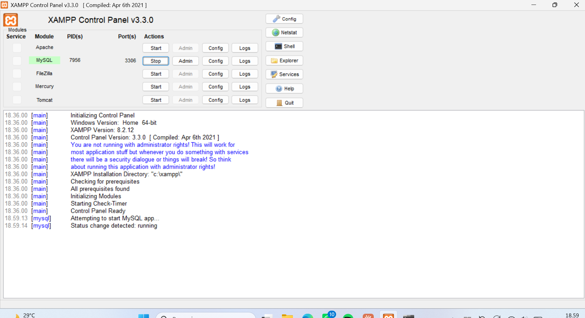
Layanan MariaDB di XAMPP Control Panel berhasil dinyalakan dan berjalan pada port 3307.

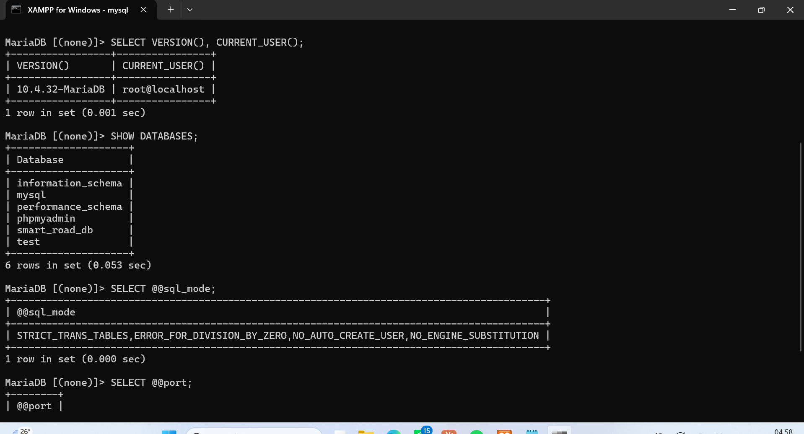
Menampilkan informasi versi MariaDB 10.4.32, koneksi akun `root@localhost`, dan konfigurasi `sql_mode` yang mencakup `STRICT_TRANS_TABLES`.

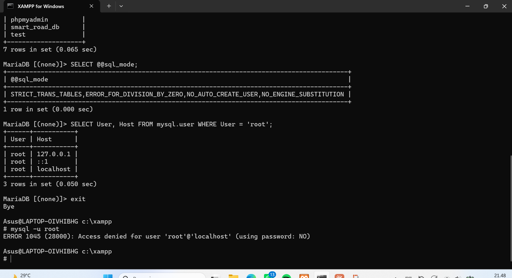
Percobaan login `root` tanpa menyertakan argumen password (`-p`) menghasilkan galat 1045 karena password `root` sudah diatur.

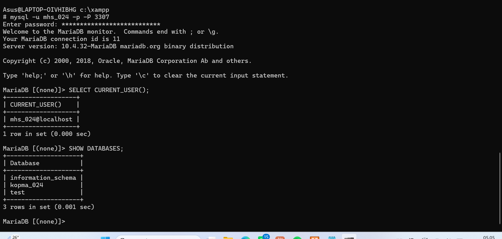
Akun `mhs_024` hanya dapat melihat database yang diberi izin (`kopma_024`), `information_schema`, serta database `test`.

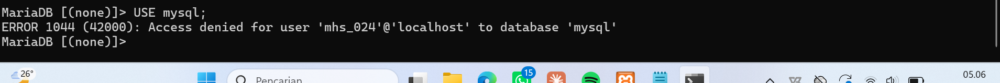
Muncul galat 1044 saat akun `mhs_024` mencoba mengakses database sistem `mysql` karena tidak memiliki hak akses yang diizinkan untuk database tersebut.

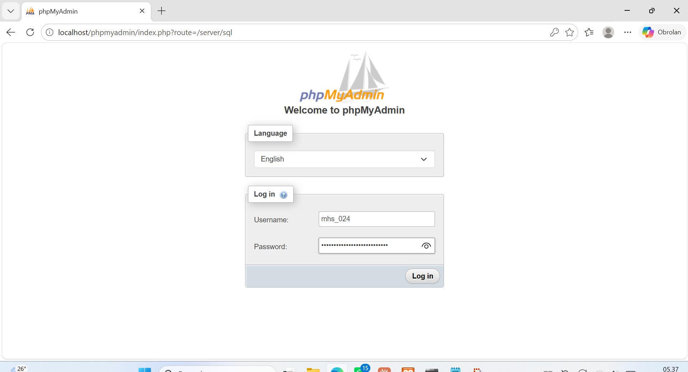
Halaman login phpMyAdmin berjalan menggunakan mode *cookie* pada port 3307.

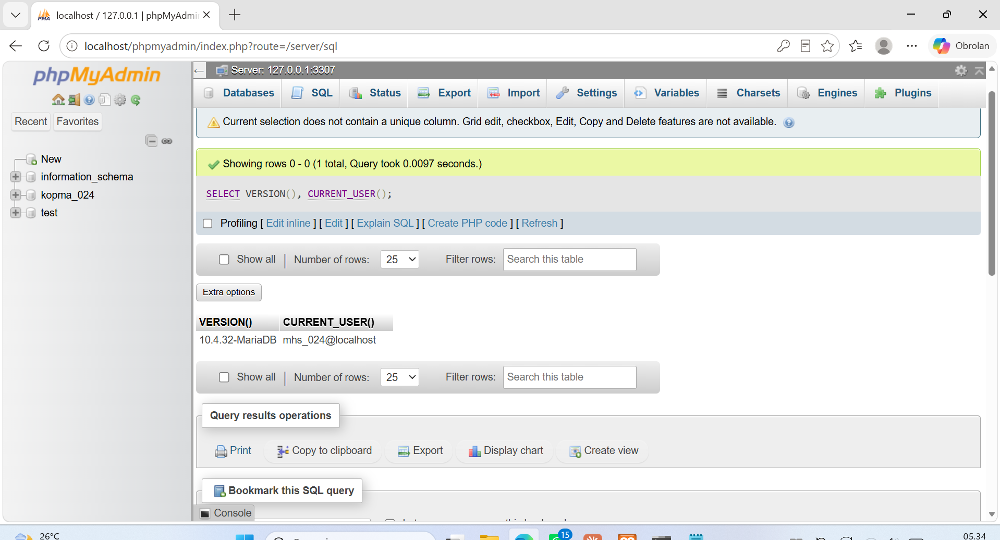
Eksekusi query SQL berhasil dijalankan di phpMyAdmin menggunakan akun `mhs_024@localhost`, dengan informasi header server `127.0.0.1:3307`.

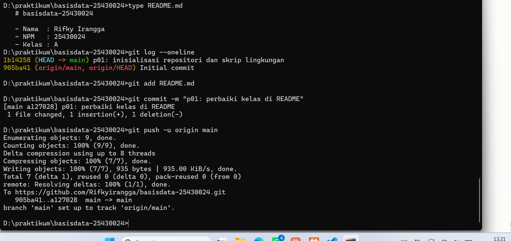
Proses pengiriman commit (*push*) berhasil dilakukan setelah penyelarasan riwayat menggunakan *rebase*.

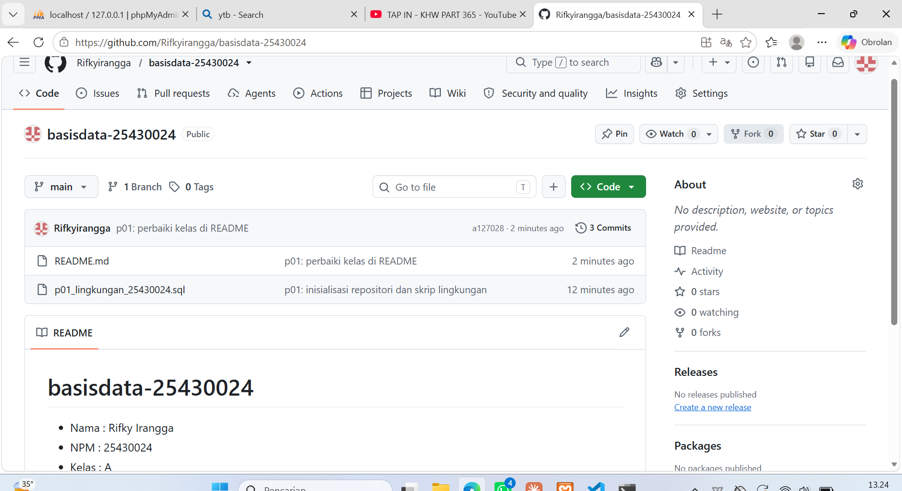
Halaman repositori GitHub yang menampilkan berkas proyek yang telah berhasil terunggah secara publik.

---

## 4. Jawaban Titik Analisis

1. **Label “MySQL” padahal yang terpasang MariaDB:**
   Akibat menggunakan label "MySQL" padahal server yang terpasang adalah MariaDB, saat mencari solusi galat di internet kita bisa menemui perbedaan perilaku pada versi fitur tertentu, mekanisme *plugin* autentikasi, atau variabel bawaan sistem yang tidak sepenuhnya identik. Dokumentasi resmi MySQL tetap relevan untuk sintaks standar SQL dasar, namun kita harus merujuk ke dokumentasi resmi MariaDB ketika berurusan dengan manajemen *engine* penyimpanan khusus (seperti Aria), variabel sistem internal, atau fitur unik yang dikembangkan setelah MariaDB bercabang dari MySQL.

2. **Bagian pesan galat 1045 yang menunjukkan password tidak dikirim:**
   Terlihat pada frasa **`(using password: NO)`**. Hal ini menandakan klien mencoba melakukan autentikasi tanpa mengirimkan parameter kata sandi sama sekali.

3. **Kenapa `information_schema` terlihat oleh `mhs_024` tetapi `mysql` ditolak, dan beda 1044 vs 1045:**
   * `information_schema` adalah *read-only view* standar SQL yang menyediakan metadata untuk semua pengguna. Sebaliknya, database `mysql` berisi tabel autentikasi dan hak akses sensitif seluruh sistem, sehingga dibatasi ketat.
   * **Perbedaan Tingkat Penolakan Galat 1044, 1045, dan 1142:**
     * **Galat 1045:** Penolakan terjadi pada **pintu masuk server** (otentikasi gagal akibat salah kata sandi atau tidak mengirimkan password). Pengguna belum tercatat masuk ke dalam sesi server.
     * **Galat 1044:** Penolakan terjadi pada **tingkat database**. Pengguna sudah berhasil masuk ke server, tetapi mencoba mengakses atau membuat database yang tidak memiliki hak akses (*privilege*).
     * **Galat 1142:** Penolakan terjadi pada **tingkat jenis perintah (perintah spesifik)**. Pengguna sudah berada di dalam database yang diizinkan, tetapi mencoba mengeksekusi perintah terlarang (seperti `CREATE TABLE` pada akun *tamu* yang hanya diberi hak `SELECT`).

4. **Kenapa mode `cookie` di phpMyAdmin lebih aman daripada mode `config`:**
   Pada mode `config`, username dan password disimpan secara *hardcode* dalam file `config.inc.php` sehingga siapa pun yang bisa membuka phpMyAdmin langsung masuk tanpa autentikasi. Mode `cookie` mewajibkan pengguna memasukkan password pada form login setiap kali sesi dimulai, dan kredensial disimpan terenkripsi di dalam *cookie* browser sementara.

---

## 5. Hasil Latihan dan Modifikasi

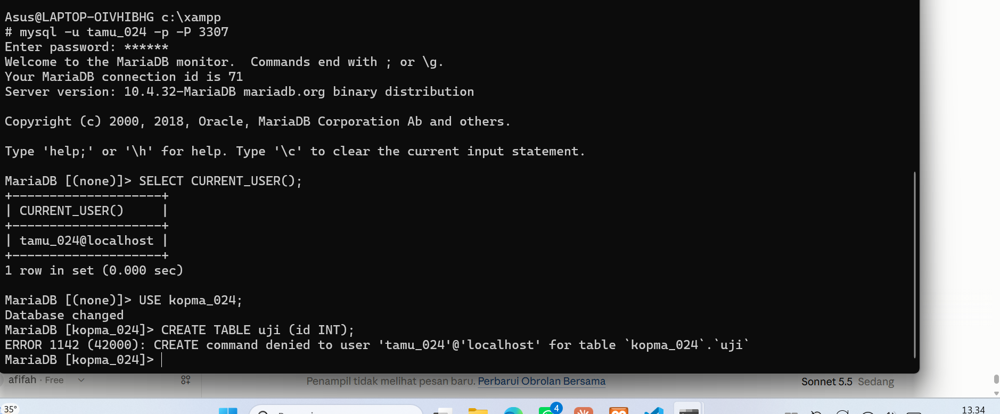
Akun `tamu_024` yang hanya diberikan hak akses `SELECT` mengalami galat 1142 (`CREATE command denied`) ketika mencoba membuat tabel baru.

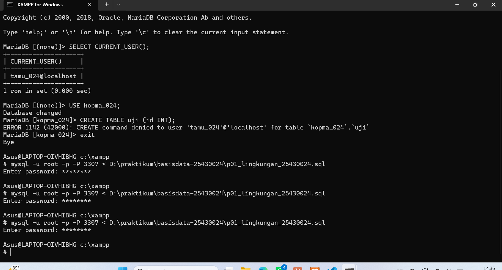
Skrip SQL yang dimodifikasi menggunakan klausa `IF NOT EXISTS` berhasil dijalankan berulang kali secara aman (*idempotent*) tanpa menghasilkan galat penolakan.

**Alasan klausa `IF NOT EXISTS` membuat skrip aman diulang:**
Klausa `IF NOT EXISTS` membuat MariaDB mengecek keberadaan objek (seperti database atau tabel) terlebih dahulu. Jika objek sudah ada, MariaDB tidak akan membuat ulang objek tersebut, sehingga struktur yang ada tidak tertimpa dan akun/tabel tidak dibuat dari awal. Hal ini membuat skrip dapat dijalankan berulang kali tanpa memicu galat duplikasi objek.

---

## 6. Tugas Mandiri: Milestone Proyek 1

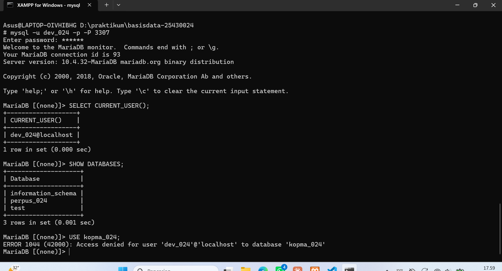
Uji coba isolasi akun proyek: akun `dev_024` ditolak aksesnya ke database `kopma_024` dengan menghasilkan galat 1044.

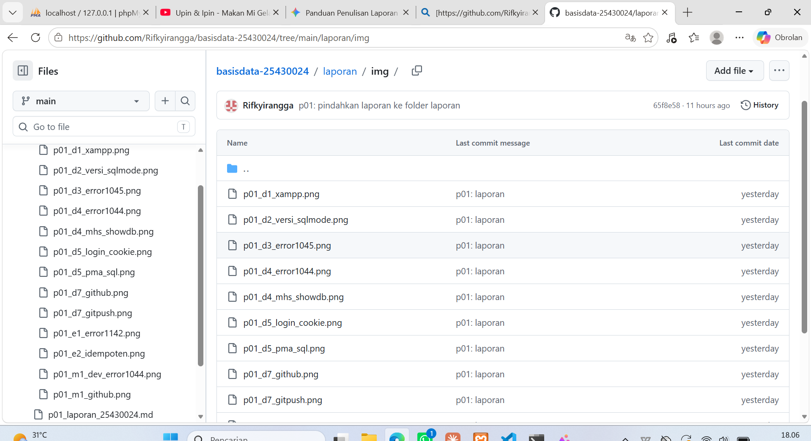
Hasil perintah `git push` setelah penambahan struktur proyek Milestone 1.

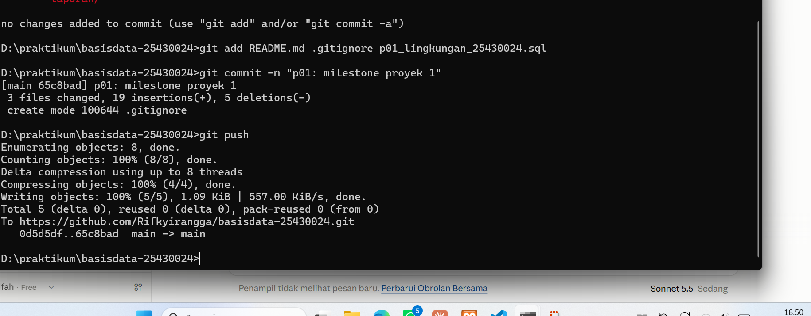
Tampilan repositori GitHub yang telah memuat struktur identitas proyek perpustakaan, `.gitignore`, dan skrip SQL.

* **Nama Organisasi Fiktif:** Perpustakaan Digital Raharsa Inspirasi (memuat inisial RI dari Rifky Irangga).
* **Lingkup Layanan:** Menyediakan layanan literasi digital bagi civitas akademika , mengelola koleksi pustaka, dengan batasan peminjaman maksimal 9 item, masa pinjam selama 7 hari, serta denda keterlambatan sebesar Rp7.000 per hari.
* **Tema Proyek:** Perpustakaan (NPM berakhiran 24).
* **Nilai Parameter P:** P = 7 (berdasarkan NPM 25430024).
* **Isi `.gitignore`:** Berisi pola `*.env` dan `kredensial*.txt`. Tujuannya agar file konfigurasi lokal dan file yang berisi kredensial sensitif tidak ikut terkirim ke repositori publik di GitHub.
* **Isolasi Akun:** Akun `dev_024` terbukti hanya dapat mengelola database miliknya sendiri (`perpus_024`) dan ditolak (menghasilkan galat 1044) saat mencoba mengakses database lain seperti `kopma_024`, demi menjaga prinsip isolasi basis data dan keamanan akses (*least privilege*).

---

## 7. Pembahasan dan Kendala

1. **Port 3306 diduga tidak dapat menyala (tidak hijau):**
   * *Pesan/Masalah:* Port 3306 diduga terblokir atau telah digunakan oleh layanan lain (berdasarkan hasil pemeriksaan `netstat -ano | findstr :3306`).
   * *Artinya:* Server MariaDB gagal *binding* ke port default 3306.
   * *Solusi:* Mengubah konfigurasi port di `my.ini` ke 3307 dan login via CLI menggunakan parameter `-P 3307`.
2. **Galat ERROR 1045 (28000) Access Denied (using password: NO):**
   * *Pesan:* `ERROR 1045 (28000): Access denied for user 'root'@'localhost' (using password: NO)`.
   * *Artinya:* Mencoba login `root` tanpa kata sandi, padahal password sudah dikonfigurasi.
   * *Solusi:* Menyertakan flag `-p` saat melakukan perintah login CLI.
3. **Kendala tambahan: Galat menggunakan password salah (using password: YES):**
   * *Pesan:* `ERROR 1045 (28000): Access denied for user 'root'@'localhost' (using password: YES)`.
   * *Artinya:* Kata sandi root yang diketikkan tidak cocok dengan sandi yang tersimpan di sistem.
   * *Solusi:* Mengakses ulang melalui mode bebas sandi sementara (`--skip-grant-tables`), lalu memperbarui password root menggunakan perintah `ALTER USER 'root'@'localhost' IDENTIFIED BY 'password_baru';` hingga berhasil login kembali.
4. **Layar `mysql -u root -p` sempat menggantung:**
   * *Pesan/Masalah:* Terminal CLI tidak merespons perintah baru.
   * *Artinya:* Diduga proses server MariaDB mengalami jeda atau di-restart.
   * *Solusi:* Membuka Shell XAMPP baru, mengonfirmasi log, dan memastikan layanan MariaDB di XAMPP Control Panel menyala kembali.
5. **Ketik perintah SQL ditolak `'SELECT' is not recognized`:**
   * *Pesan:* `'SELECT' is not recognized as an internal or external command...`
   * *Artinya:* Perintah SQL diketik di prompt terminal Windows, bukan di dalam prompt MariaDB.
   * *Solusi:* Melakukan login ke server MariaDB terlebih dahulu.
6. **Layanan `localhost/phpmyadmin` tidak terjangkau:**
   * *Pesan:* Halaman web tidak dapat dimuat di peramban.
   * *Artinya:* Server web Apache di XAMPP belum dijalankan.
   * *Solusi:* Menekan tombol *Start* pada modul Apache di Control Panel XAMPP.
7. **Galat ERROR 1396 (HY000) saat `CREATE USER`:**
   * *Pesan:* `ERROR 1396 (HY000): Operation CREATE USER failed for 'tamu_024'@'localhost'`.
   * *Artinya:* Akun pengguna yang akan dibuat sudah ada di dalam tabel `mysql.user`.
   * *Solusi:* Memeriksa isi `mysql.user`, lalu menggunakan perintah `ALTER USER` atau menambahkan sintaks `IF NOT EXISTS`.
8. **Perintah `git push` ditolak (`fetch first`):**
   * *Pesan:* `! [rejected] main -> main (fetch first)`.
   * *Artinya:* Repositori GitHub sudah memiliki commit awal yang belum ada di repositori lokal.
   * *Solusi:* Menjalankan `git fetch`, dilanjutkan dengan `git pull --rebase origin main`, lalu melakukan `git push` kembali.
9. **Tampilan Editor Vim terbuka saat rebase:**
   * *Pesan/Masalah:* Terminal terkunci di tampilan antarmuka Vim.
   * *Artinya:* Git meminta konfirmasi pesan *commit* saat penggabungan riwayat.
   * *Solusi:* Menekan tombol `Esc`, mengetik `:wq`, lalu menekan `Enter`.
10. **Kesalahan penulisan kelas pada dokumen:**
    * *Pesan/Masalah:* Kelas tertulis "B" pada draf awal.
    * *Artinya:* Terjadi kesalahan ketik data identitas.
    * *Solusi:* Memperbaiki teks menjadi "Kelas A" dan mencatat perubahan dalam commit terpisah (`a127028`).
11. **Kesalahan penempatan berkas awal:**
    * *Pesan/Masalah:* Berkas `README.md` dan `.sql` dipindah sebelum commit pertama (tidak memerlukan commit ulang), sedangkan berkas laporan sempat tersimpan sementara di direktori `laporan/img/` sebelum dipindahkan secara bersih menggunakan perintah `git mv` (tercatat pada commit `65f8e58`).
    * *Solusi:* Menyusun struktur folder kerja dengan benar dan mencatat riwayat pemindahan berkas laporan.

---

## 8. Kesimpulan
1. Konfigurasi port server MariaDB ke 3307 dan pengamanan akun `root` berhasil dilakukan tanpa mengganggu akses sistem.
2. Penerapan hak akses terbatas (*least privilege*) terbukti efektif membatasi ruang gerak akun pengguna biasa (`mhs_024`, `dev_024`, dan `tamu_024`) sesuai perannya masing-masing.
3. Manajemen repositori menggunakan Git dan GitHub mempermudah melacak riwayat perubahan berkas SQL dan laporan praktikum secara terstruktur.

---

## 9. Pernyataan Penggunaan AI
Saya menyatakan bahwa dalam penyelesaian Tugas Modul 1 ini saya menggunakan alat bantu AI berupa **Claude**. 

**Penggunaan AI meliputi:**
* Claude membantu memberikan ringkasan alur pengerjaan, daftar kendala, pemetaan gambar, perhitungan parameter P = 7, penjelasan arti pesan galat (1044, 1045, 1142, 1396), serta memandu sintaks perintah MariaDB dan Git (`pull --rebase`).
* Claude memberikan acuan kerangka struktur laporan serta draf kalimat awal untuk paragraf lingkup layanan yang kemudian saya telaah dan sesuaikan.

**Hal-hal yang saya tentukan dan kerjakan secara mandiri meliputi:**
* Menjalankan seluruh perintah di terminal lokal komputer.
* Memilih nama organisasi fiktif perpustakaan beserta penyusunan kalimat lingkup layanan agar sesuai dengan isi berkas `README.md`.
* Menelaah, menyesuaikan, memahami, serta mempraktikkan seluruh materi laporan ini secara mandiri dan siap mempertanggungjawabkannya saat sesi viva.

---

## 10. Bukti Git
* **Tautan Repositori GitHub:** [https://github.com/Rifkyirangga/basisdata-25430024](https://github.com/Rifkyirangga/basisdata-25430024)
* **Riwayat Commit Utama:**
  * `905ba41` Initial commit (otomatis dari GitHub)
  * `1b14258` p01: inisialisasi repositori dan skrip lingkungan
  * `a127028` p01: perbaiki kelas di README
  * `0d5d5df` p01: latihan akun tamu dan skrip idempoten
  * `65c8bad` p01: milestone proyek 1
  * `272434f` p01: laporan
  * `65f8e58` p01: pindahkan laporan ke folder laporan
* **Hash Commit Laporan:** `272434f`

---

## Checklist
- [x] `p01_lingkungan_25430024.sql` (dapat dijalankan ulang), `README.md` berisi Identitas Proyek, `.gitignore`
- [x] Screenshot: `SELECT VERSION(), CURRENT_USER();`, `SELECT @@sql_mode;`, `SHOW DATABASES` sebagai `mhs_024` dan `dev_024`; galat 1044 dan 1142; halaman masuk phpMyAdmin mode cookie; git push pertama
- [x] Titik Analisis 1-4; perbedaan kode galat 1044, 1045, dan 1142