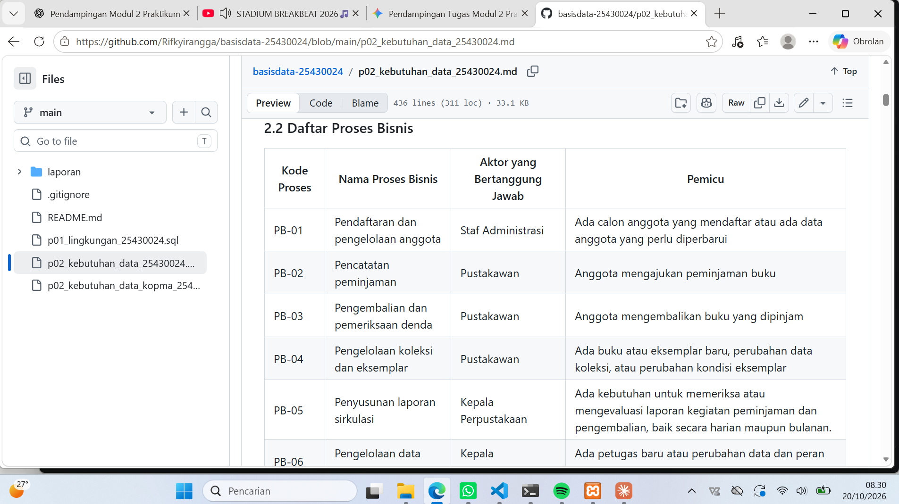
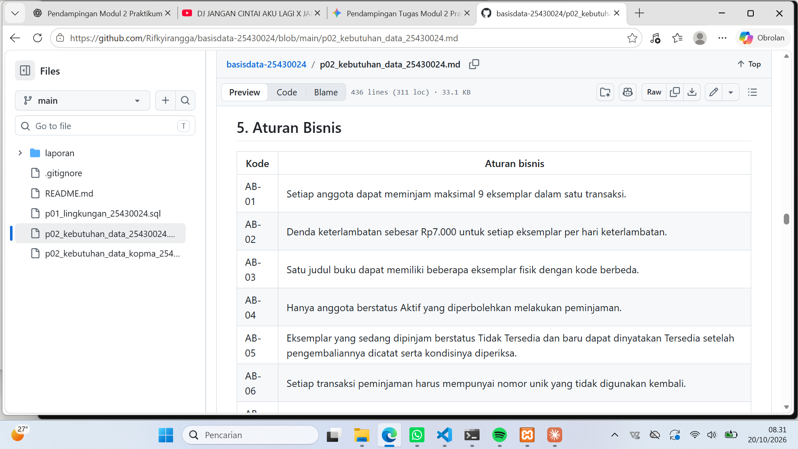
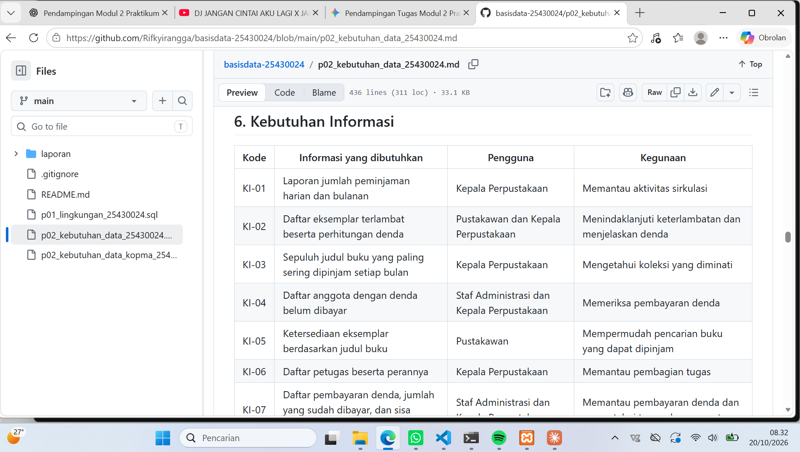
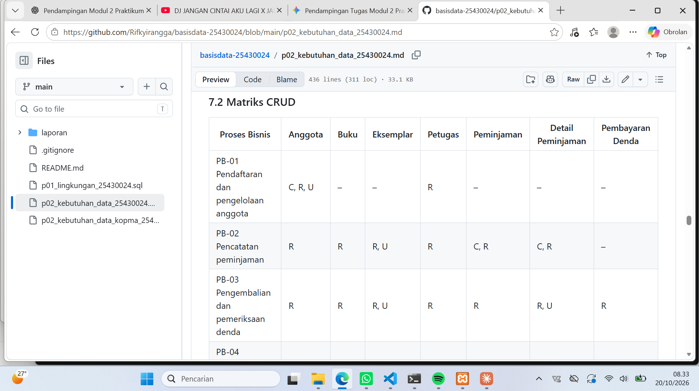
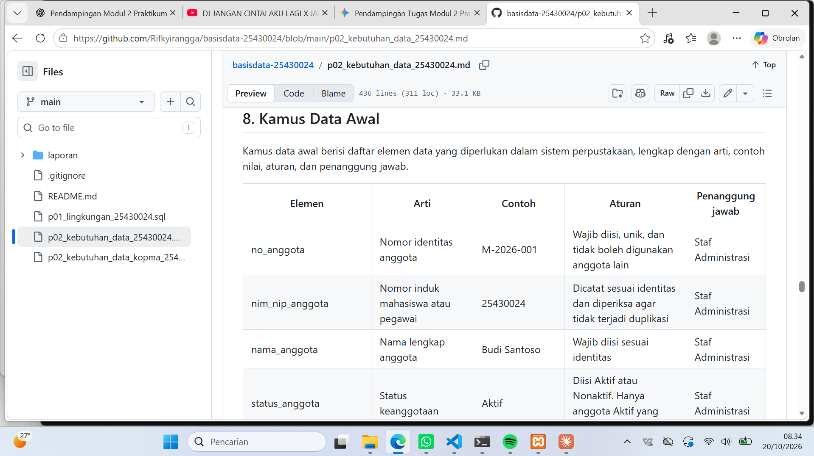

# Laporan Praktikum Basis Data
**Nama:** Rifky Irangga  
**NIM:** 25430024  
**Kelas:** A  
**Tanggal:** 20 Oktober 2026  
**Asisten/Dosen:** Dedi Irawan, S.Kom., M.T.I
---

## 1. Tujuan Praktikum
1. Memahami pentingnya analisis kebutuhan pengelolaan data sebelum melakukan perancangan basis data.
2. Mampu mengidentifikasi proses bisnis, entitas utama, aturan bisnis, dan kebutuhan informasi dalam sistem pengelolaan data perpustakaan.
3. Mampu menyusun matriks CRUD serta kamus data awal dengan melampirkan peran penanggung jawab (*data steward*).
4. Mampu memperkirakan parameter volume data dan menganalisis isu kualitas data yang diantisipasi.

## 2. Ringkasan Dasar Teori
Analisis kebutuhan data merupakan tahap krusial dalam siklus hidup perancangan basis data. Tanpa pemahaman kebutuhan yang matang, basis data yang dibangun berisiko mengalami anomali, duplikasi, atau kegagalan pencatatan transaksi. Data perlu dikelola sebagai aset penting organisasi dengan menetapkan struktur, aturan bisnis, dan penanggung jawab (*data steward*) yang jelas. Pemetaan operasi data menggunakan matriks CRUD memastikan bahwa setiap proses bisnis memiliki hak akses data yang sesuai tanpa kehilangan transparansi riwayat audit.

## 3. Hasil Langkah Percobaan
Berikut adalah bukti tampilan dokumen kebutuhan data proyek perpustakaan "Perpustakaan Digital Raharsa Inspirasi" yang diakses dari halaman *Preview* repositori GitHub:

*Gambar 3.1: Tabel Proses Bisnis PB-01 sampai PB-07 pada berkas p02_kebutuhan_data_25430024.md.*

*Gambar 3.2: Tabel Aturan Bisnis AB-01 sampai AB-11.*

*Gambar 3.3: Tabel Kebutuhan Informasi KI-01 sampai KI-07.*

*Gambar 3.4: Tabel Matriks CRUD yang memetakan hubungan proses bisnis dan entitas.*

*Gambar 3.5: Tabel Kamus Data Awal beserta contoh, aturan, dan penanggung jawab.*

## 4. Jawaban Titik Analisis
- **Titik Analisis 1:** Nota tetap perlu menyimpan harga barang pada saat transaksi terjadi meskipun harga barang sudah ada pada tabel master barang. Hal ini dikarenakan harga barang dapat berubah sewaktu-waktu. Jika nota hanya merujuk ke tabel master, maka riwayat harga pada transaksi lama akan ikut berubah (keliru secara akuntansi).
- **Titik Analisis 2:** Nilai turunan seperti subtotal, total harga, atau sisa denda tidak disimpan dalam tabel operasional utama untuk menjaga konsistensi data dan mencegah duplikasi data (*redundancy*). Nilai-nilai tersebut sebaiknya dihitung secara dinamis saat laporan dipanggil, kecuali jika ada kebutuhan performa atau historis khusus.
- **Titik Analisis 3:** Pada matriks CRUD, status aktif anggota diubah oleh Staf Administrasi melalui proses pendaftaran dan pengelolaan anggota (PB-01).

## 5. Hasil Latihan dan Modifikasi
Hasil analisis kebutuhan data telah disesuaikan untuk mengatasi permasalahan operasional perpustakaan, seperti penetapan batas maksimal peminjaman berdasarkan parameter NIM, pencatatan tarif denda historis, dan transparansi pencatatan pembayaran denda secara bertahap.

## 6. Tugas Mandiri: Milestone Proyek 2
Dokumen kebutuhan data lengkap untuk "Perpustakaan Digital Raharsa Inspirasi" telah disusun pada berkas `p02_kebutuhan_data_25430024.md`.
- **Parameter NIM:** Dua digit terakhir NIM = 24, sehingga $P = (24 \bmod 9) + 1 = 7$.
- **Estimasi Volume Data:** Transaksi peminjaman harian = $40 + (5 \times 7) = 75$ transaksi/hari (2.250 transaksi/bulan).
- **Cakupan Dokumen:** Memuat 7 proses bisnis, 7 entitas utama, 11 aturan bisnis, 7 kebutuhan informasi, matriks CRUD komprehensif, kamus data awal 27 elemen, serta 14 isu kualitas data.

## 7. Pembahasan dan Kendala
- **Kendala:** Membedakan antara elemen data yang perlu disimpan secara permanen dengan elemen data hasil perhitungan (seperti hari keterlambatan dan sisa denda).
- **Penanganan:** Menambahkan catatan penjelas pada kamus data dan aturan bisnis (`AB-11`) bahwa nilai turunan dihitung berdasarkan selisih tanggal pengembalian dan transaksi pembayaran yang dicatat.

## 8. Kesimpulan
Dokumen kebutuhan data merupakan fondasi penting sebelum melangkah ke tahap pemodelan ERD dan pembuatan skema basis data. Dengan penetapan aturan bisnis yang tegas dan penanggung jawab data yang spesifik, integritas dan kualitas data perpustakaan dapat terjaga secara berkelanjutan.

## 9. Pernyataan Penggunaan AI
Pengembangan dan pemikiran struktur analisis dilakukan secara mandiri. AI (Gemini) digunakan sebagai rekan kolaborasi (*collaborator*) untuk membantu melakukan peninjauan (*review*), pemeriksaan konsistensi penamaan atribut, serta pengecekan kelengkapan format Markdown laporan.

## 10. Bukti Git
- **Tautan Repositori:** https://github.com/Rifkyirangga/basisdata-25430024
- **Kode Commit (Hash):** 0bb907106a2d69129fefe7417b00e4740b9c4859

## Checklist
- [x] Berkas dokumen kebutuhan data proyek terunggah di repositori (`p02_kebutuhan_data_25430024.md`)
- [x] Tangkapan layar tabel proses, entitas, aturan, CRUD, dan kamus data ada di folder `laporan/img/`
- [x] Jawaban Titik Analisis 1-3 lengkap dengan alasan
- [x] Perhitungan parameter P tercantum dengan benar ($P = 7$)