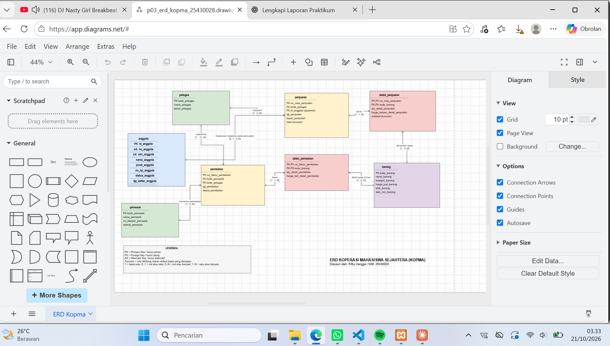
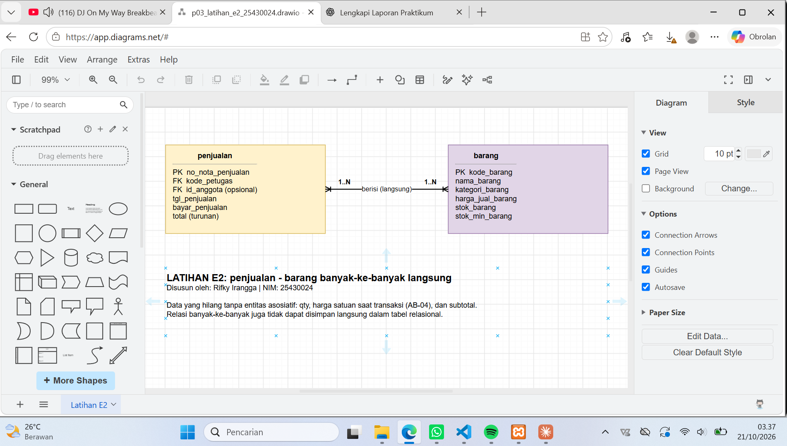
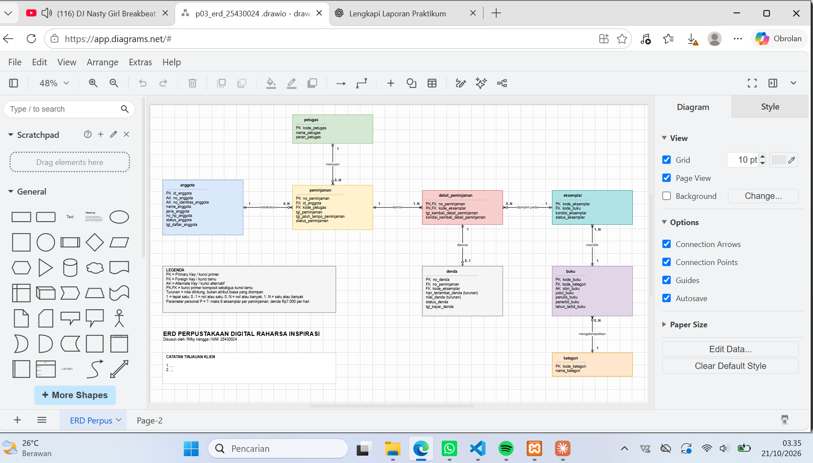

# Laporan Praktikum Basis Data - Pertemuan 03
**Nama:** Rifky Irangga   
**NIM:** 25430024   
**Kelas:** A  
**Tanggal:** 20 Oktober 2026   
**Asisten/Dosen:** Dedi Irawan, S.Kom.,M.T.I

## 1. Tujuan Praktikum
Mengubah dokumen kebutuhan data menjadi gambar ERD yang dapat dibaca pengurus. Saya mengidentifikasi entitas, atribut, dan kunci; menentukan relasi dan kardinalitas berdasarkan aturan bisnis; memecah relasi banyak-ke-banyak menjadi entitas asosiatif; lalu menggambar ERD Crow's Foot di draw.io dan mengujinya dengan kebutuhan informasi (KI).

## 2. Ringkasan Dasar Teori
* **ERD:** Representasi konseptual dari data dalam suatu organisasi yang mencakup entitas, atribut, dan relasi.
* **Kardinalitas dan Partisipasi:** Kardinalitas menyatakan jumlah maksimum instansiasi hubungan (berapa paling banyak), sedangkan partisipasi menyatakan apakah keberadaan suatu entitas bergantung secara wajib atau boleh tidak ada.
* **Relasi Banyak-ke-Banyak:** Relasi banyak-ke-banyak harus dipecah dengan menggunakan entitas asosiatif agar dapat diimplementasikan ke dalam model relasional, di mana entitas asosiatif ini dapat memuat atributnya sendiri (seperti jumlah dan harga transaksi).
* **Atribut Turunan:** Atribut yang nilainya dapat dihitung dari atribut lain dan biasanya tidak disimpan secara permanen di dalam basis data operasional.

## 3. Hasil Langkah Percobaan

### 3.1 Dari entitas kandidat ke entitas
Delapan entitas Kopma: anggota, petugas, barang, penjualan, detail_penjualan, pemasok, pembelian, detail_pembelian. Pembelian dipecah menjadi pembelian dan detail_pembelian, sama seperti penjualan. Atribut kunci (PK), kunci tamu (FK), kunci alternatif (AK), dan atribut turunan sudah ditandai.

### 3.2 Relasi dan kardinalitas Kopma
| Relasi | Sisi kiri | Sisi kanan | Dasar |
|---|---|---|---|
| petugas melayani penjualan | tepat satu petugas | nol atau banyak penjualan | PB-02, wawancara kasir |
| anggota melakukan penjualan | nol atau satu anggota | nol atau banyak penjualan | AB-02 |
| penjualan berisi detail_penjualan | tepat satu penjualan | satu atau banyak detail | AB-01 |
| barang tercantum pada detail_penjualan | tepat satu barang | nol atau banyak detail | AB-04 |
| pemasok menerima pembelian | tepat satu pemasok | nol atau banyak pembelian | AB-06 |
| pembelian berisi detail_pembelian | tepat satu pembelian | satu atau banyak detail | faktur pemasok |
| barang dibeli pada detail_pembelian | tepat satu barang | nol atau banyak detail | faktur pemasok, PB-04 |
| petugas menerima pembelian | tepat satu petugas | nol atau banyak pembelian | usulan AB-07, PB-04 |

### 3.3 ERD Kopma

> **Keterangan:** ERD Kopma di draw.io yang memuat delapan entitas lengkap dengan atribut, kunci, serta kardinalitas pada kedua ujung garis relasi.

### 3.4 Penelusuran KI terhadap ERD Kopma
| KI | Kebutuhan | Jalur di ERD | Atribut yang dipakai |
|---|---|---|---|
| KI-01 | Omzet dan jumlah nota per hari/bulan | penjualan → detail_penjualan (+ anggota untuk diskon) | tgl_penjualan, no_nota_penjualan, qty_detail_penjualan, harga_satuan_detail_penjualan, status_anggota |
| KI-02 | Lima barang terlaris per bulan | penjualan → detail_penjualan → barang | tgl_penjualan, kode_barang, qty_detail_penjualan, nama_barang |
| KI-03 | Barang dengan stok di bawah batas minimum | barang | stok_barang, stok_min_barang |
| KI-04 | Sepuluh anggota dengan belanja terbesar per bulan | anggota → penjualan → detail_penjualan | id_anggota, nama_anggota, tgl_penjualan, qty_detail_penjualan, harga_satuan_detail_penjualan |

### 3.5 Pemetaan entitas Kopma ke proses bisnis
| Entitas | Proses bisnis |
|---|---|
| anggota | PB-01, PB-05, PB-06 |
| barang | PB-02, PB-03, PB-04, PB-05, PB-06 |
| petugas | PB-02, PB-03, PB-04, PB-05, PB-06 |
| penjualan, detail_penjualan | PB-02, PB-05 |
| pemasok | PB-03, PB-04, PB-06 |
| pembelian, detail_pembelian | PB-03, PB-04, PB-05 |

### 3.6 Catatan tinjauan klien (Kopma)
| No | Umpan balik | Keputusan | Alasan |
|---|---|---|---|
| 1 | [ISI] | [diterima/ditolak] | [ISI] |
| 2 | [ISI] | [diterima/ditolak] | [ISI] |

## 4. Jawaban Titik Analisis

**Titik Analisis 1.** `id_anggota` dipakai sebagai kunci primer karena nilainya dibuat oleh sistem, tidak bermakna, dan tidak perlu berubah. NIM dan no_anggota memang unik, tetapi tetap sebagai kunci alternatif. Risiko jika NIM menjadi kunci primer: NIM bisa salah ketik atau berubah, dan perubahannya harus ditelusuri di semua tabel yang merujuknya (penjualan). NIM juga membuat identitas pribadi tersebar di banyak tabel.

**Titik Analisis 2.** Aturan AB-01 (setiap nota memuat minimal satu baris barang) memaksa sisi detail bernilai satu atau banyak. Struktur tabel saja tidak cukup untuk menjaganya: kunci tamu hanya menjamin detail merujuk ke nota yang ada, bukan bahwa nota pasti punya detail. Nota kosong tetap bisa tersimpan jika kepala nota dimasukkan lebih dulu. Karena itu perlu transaksi (Modul 14) yang menyimpan nota beserta detailnya sekaligus.

**Titik Analisis 3.** ERD saat ini dapat menjawabnya lewat jalur pemasok → pembelian → petugas, karena pembelian menyimpan `kode_petugas` (petugas penerima). Relasi petugas–pembelian ditambahkan karena entitas kandidat Pembelian sudah mencantumkan petugas penerima. Keputusan ini perlu dicatat sebagai aturan bisnis baru, usulan AB-07: setiap pembelian dicatat bersama petugas gudang yang menerima barang.

## 5. Hasil Latihan dan Modifikasi

**Latihan E1 (poin loyalitas).** Pilihan saya adalah membuat entitas terpisah bernama `riwayat_poin` yang berelasi 1 ke 0..N dengan anggota dan merujuk ke penjualan. Alasannya, pengurus tidak hanya butuh mengetahui jumlah akumulasi poin saat ini, tetapi juga memerlukan jejak audit riwayat kapan poin tersebut diperoleh atau ditukarkan dari transaksi tertentu. Perlu dicatat bahwa entitas `riwayat_poin` ini tidak digambar ke dalam ERD utama Kopma karena merupakan bagian dari variasi latihan mandiri.

**Latihan E2 (penjualan–barang banyak-ke-banyak langsung).** Tanpa entitas asosiatif, data yang hilang adalah `qty` dan harga satuan saat transaksi (AB-04), sehingga subtotal dan riwayat harga tidak bisa dicatat. Relasi banyak-ke-banyak juga tidak dapat disimpan langsung dalam tabel relasional. 

## 6. Tugas Mandiri: Milestone Proyek 3

### 6.1 ERD proyek: Perpustakaan Digital Raharsa Inspirasi (perpus)

Berkas: `p03_erd_25430024.drawio` dan `p03_erd_25430024.png`. Parameter personal: P = (24 mod 9) + 1 = 7, sehingga maksimal 9 eksemplar per peminjaman, denda Rp7.000 per hari, dan perkiraan 75 peminjaman per hari.

Entitas asosiatif: **detail_peminjaman**, yang menghubungkan peminjaman dan eksemplar dan memiliki atribut sendiri (`tgl_kembali_detail_peminjaman`, `kondisi_kembali_detail_peminjaman`).

### 6.2 Relasi dan kardinalitas proyek
| Relasi | Sisi kiri | Sisi kanan | Dasar |
|---|---|---|---|
| anggota melakukan peminjaman | tepat satu anggota | nol atau banyak peminjaman | AB-P02 |
| petugas melayani peminjaman | tepat satu petugas | nol atau banyak peminjaman | AB-P07 |
| peminjaman berisi detail_peminjaman | tepat satu peminjaman | satu atau banyak detail | AB-P03 |
| eksemplar dipinjam pada detail_peminjaman | tepat satu eksemplar | nol atau banyak detail | AB-P05 |
| buku memiliki eksemplar | tepat satu buku | satu atau banyak eksemplar | AB-P01 |
| kategori mengelompokkan buku | tepat satu kategori | nol atau banyak buku | katalog |
| detail_peminjaman dikenai denda | tepat satu detail | nol atau satu denda | AB-P06 |

### 6.3 Penelusuran KI proyek
| KI | Kebutuhan | Jalur di ERD |
|---|---|---|
| KI-P01 | Sepuluh judul buku paling sering dipinjam per bulan | peminjaman → detail_peminjaman → eksemplar → buku |
| KI-P02 | Eksemplar yang melewati jatuh tempo dan belum kembali | anggota → peminjaman → detail_peminjaman → eksemplar → buku |
| KI-P03 | Total denda per bulan dan status pembayarannya | peminjaman → detail_peminjaman → denda |
| KI-P04 | Lima anggota dengan peminjaman terbanyak per bulan | anggota → peminjaman → detail_peminjaman |
| KI-P05 | Jumlah eksemplar tersedia per judul | buku → eksemplar |
| KI-P06 | Jumlah peminjaman per kategori buku per bulan | kategori → buku → eksemplar → detail_peminjaman → peminjaman |

### 6.4 Penjelasan keputusan desain
* Satu judul buku punya banyak eksemplar (AB-P01), sehingga peminjaman dicatat per eksemplar fisik.
* Pengembalian dicatat pada detail_peminjaman; atribut `tgl_kembali_detail_peminjaman` yang kosong berarti buku belum dikembalikan.
* Denda dibuat entitas sendiri karena tidak semua eksemplar terlambat (0..1 per detail).
* `hari_terlambat_denda` dan `nilai_denda` ditandai turunan; keputusan menyimpan atau menghitung ditunda ke Pertemuan 4.
* `tgl_jatuh_tempo_peminjaman` disimpan agar tidak berubah bila aturan lama pinjam berubah (AB-P04).

### 6.5 Catatan tinjauan klien (proyek)
| No | Umpan balik | Keputusan | Alasan |
|---|---|---|---|
| 1 | [ISI] | [diterima/ditolak] | [ISI] |
| 2 | [ISI] | [diterima/ditolak] | [ISI] |

## 7. Pembahasan dan Kendala
* Nama atribut pada draf ERD Kopma awalnya berbeda dari kamus data Pertemuan 2. Saya menyamakannya satu per satu karena Tabel 3.3 mewajibkan atribut sesuai kamus data.
* Sempat mengalami kendala penataan tata letak garis penghubung (*connector*) di draw.io agar tidak saling bertumpuk dengan kotak entitas lain, yang diselesaikan dengan mengatur jalur *orthogonal* secara manual.

## 8. Kesimpulan
ERD Kopma dan ERD proyek sudah memuat entitas, kunci, dan kardinalitas yang dapat ditelusuri ke aturan bisnis. Seluruh kebutuhan informasi dapat dijawab lewat jalur ERD, dan entitas asosiatif diperlukan untuk menyimpan data yang melekat pada relasi banyak-ke-banyak. Seluruh perancangan konseptual ini selanjutnya akan diuji melalui tahapan normalisasi pada Pertemuan 4.

## 9. Pernyataan Penggunaan AI
Saya menggunakan Claude (Anthropic) untuk: (1) membuat berkas awal `.drawio` ERD Kopma dan memandu pemeriksaan atribut, relasi, serta kardinalitasnya terhadap buku praktikum dan kamus data; (2) menyusun draf ERD proyek Perpustakaan beserta aturan bisnis (`AB-P`) dan kebutuhan informasi (`KI-P`) usulan; (3) menyusun kerangka dan draf sebagian isi laporan. Saya memeriksa, menyesuaikan (misalnya nama organisasi proyek dan parameter $P = 7$), dan mempelajari hasilnya sendiri. Tinjauan teman dan keputusan akhir saya kerjakan sendiri.

## 10. Bukti Git
* Repositori: [https://github.com/rifkyirangga/basisdata-25430024](https://github.com/rifkyirangga/basisdata-25430024)
* Commit: `p03: erd kopma` — hash: de7a7a92e6c90385854a8aa7ad7230c0f7b02da8

## Checklist
* [ ] Berkas wajib: `p03_erd_kopma_25430024` dan `p03_erd_25430024` (gambar + berkas sumber)
* [ ] Bukti tangkapan layar: ERD di draw.io dengan kardinalitas terbaca; catatan tinjauan klien
* [ ] Analisis wajib: pemetaan entitas ke PB/KI dari Pertemuan 2; alasan kardinalitas relasi utama
* [ ] Identitas, tujuan, ringkasan teori, langkah percobaan, Titik Analisis, latihan, tugas mandiri, pembahasan, kesimpulan, pernyataan AI, bukti Git
* [ ] Keaslian: tangkapan layar memperlihatkan akun ber-NIM dan jam sistem; nama + NIM pada ERD