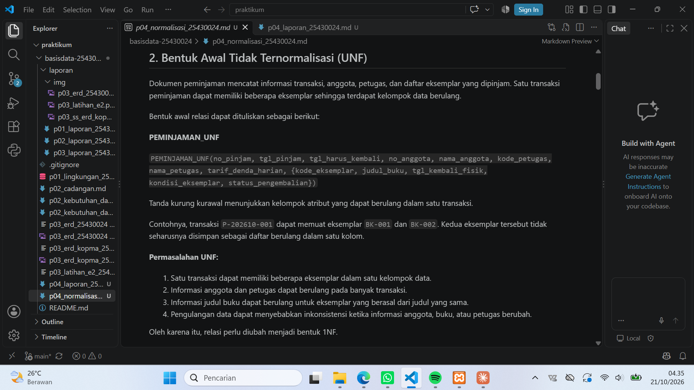
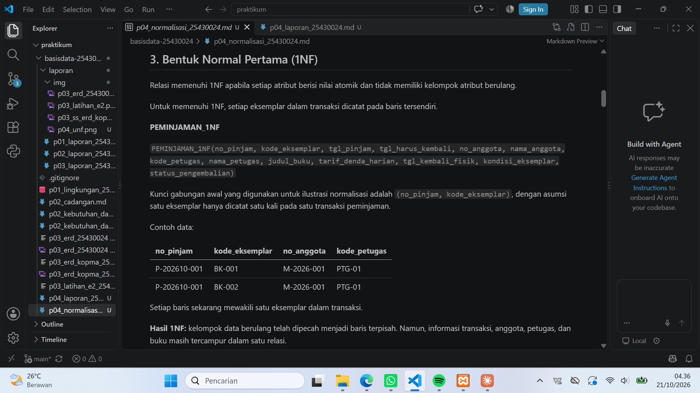
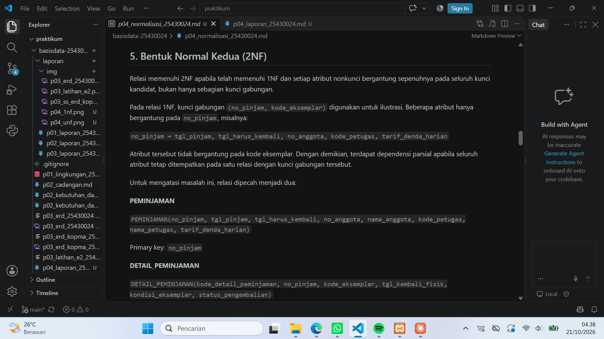
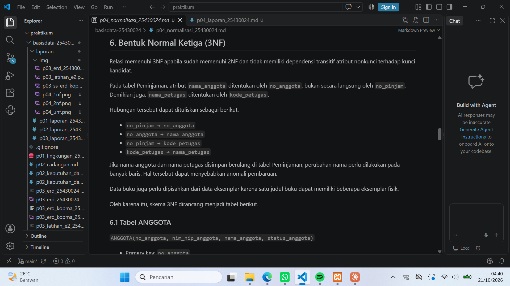

# Laporan Praktikum Basis Data - Pertemuan 4

**Nama:** Rifky Irangga  
**NIM:** 25430024  
**Kelas:** A  
**Tanggal:** 13-15 Oktober 2026  
**Asisten/Dosen:** Dedi Irawan, S.Kom., M.T.I
---

## 1. Tujuan Praktikum

1. Memahami proses normalisasi data dari bentuk tidak normal hingga Bentuk Normal Ketiga (3NF).
2. Mengidentifikasi dependensi fungsional berdasarkan aturan bisnis proyek.
3. Menyusun skema relasional yang mengurangi redundansi dan anomali data.
4. Menentukan nilai yang disimpan dan nilai turunan yang dihitung saat diperlukan.

## 2. Ringkasan Dasar Teori

Normalisasi merupakan proses penyusunan struktur tabel untuk mengurangi pengulangan data dan mencegah anomali saat data ditambahkan, diubah, atau dihapus.

- **UNF (Unnormalized Form):** data masih dapat memiliki kelompok data berulang.
- **1NF (First Normal Form):** setiap atribut berisi nilai atomik dan tidak memiliki kelompok berulang.
- **2NF (Second Normal Form):** sudah memenuhi 1NF dan setiap atribut nonkunci bergantung penuh pada seluruh kunci kandidat, bukan hanya sebagian kunci gabungan.
- **3NF (Third Normal Form):** sudah memenuhi 2NF dan tidak memiliki dependensi transitif atribut nonkunci terhadap kunci kandidat.

Dependensi fungsional menyatakan bahwa suatu atribut atau kumpulan atribut menentukan nilai atribut lain. Proses normalisasi proyek ini menggunakan aturan bisnis pada dokumen kebutuhan data Modul 2 sebagai dasar analisis.

## 3. Hasil Langkah Percobaan

### 3.1 Identifikasi Data Awal (UNF)

Data awal proses peminjaman dapat memuat informasi anggota, petugas, peminjaman, serta beberapa eksemplar buku dalam satu transaksi. Jika daftar eksemplar disimpan sebagai kelompok berulang, struktur tersebut belum memenuhi 1NF.

**Bukti:**  
Simpan screenshot tampilan bagian UNF dari `p04_normalisasi_25430024.md` di folder `laporan/img/`, lalu sesuaikan nama berkas pada tautan berikut.

### 3.2 Bentuk Normal Pertama (1NF)

Pada tahap 1NF, kelompok eksemplar yang berulang diuraikan menjadi baris terpisah. Setiap kolom berisi satu nilai untuk satu baris. Jika kunci gabungan digunakan, setiap bagiannya harus dijelaskan berdasarkan aturan bisnis.

**Bukti:**

### 3.3 Bentuk Normal Kedua (2NF)

Tahap 2NF memeriksa apakah terdapat atribut nonkunci yang hanya bergantung pada sebagian kunci gabungan. Atribut yang bergantung pada identitas anggota, buku, petugas, atau transaksi dipisahkan ke relasi yang sesuai berdasarkan dependensi fungsional yang telah diverifikasi.

**Bukti:**

### 3.4 Bentuk Normal Ketiga (3NF)

Tahap 3NF memeriksa dependensi transitif dan menghasilkan skema relasional yang memisahkan data anggota, buku, eksemplar, petugas, peminjaman, detail peminjaman, dan pembayaran denda sesuai kebutuhan proyek.

**Bukti:**

## 4. Jawaban Titik Analisis

### 4.1 Dependensi Fungsional

Dependensi fungsional harus diturunkan dari aturan bisnis yang tercantum pada dokumen kebutuhan data Modul 2. Daftar final dan kode aturan bisnis pendukungnya mengacu pada berkas `p04_normalisasi_25430024.md`.

| Dependensi fungsional | Alasan |
|---|---|
| Identitas anggota menentukan atribut anggota yang sesuai | Identitas anggota harus unik menurut aturan bisnis |
| ISBN buku menentukan atribut deskriptif buku yang sesuai | ISBN mengidentifikasi data bibliografis buku |
| Kode eksemplar menentukan buku yang diwakili dan status eksemplarnya | Setiap eksemplar memiliki identitas tersendiri |
| Kode petugas menentukan atribut petugas yang sesuai | Kode petugas membedakan petugas |
| Nomor peminjaman menentukan atribut utama transaksi peminjaman | Nomor peminjaman mengidentifikasi transaksi |
| Identitas detail peminjaman menentukan data detail terkait | Setiap detail harus dapat diidentifikasi |
| Nomor pembayaran menentukan data pembayaran terkait | Nomor pembayaran mengidentifikasi pembayaran |

**Catatan:** Nama atribut dan kode aturan bisnis harus sama dengan dokumen kebutuhan data dan berkas normalisasi proyek. Jangan mencentang laporan sebagai selesai sebelum kecocokan tersebut diperiksa.

### 4.2 Keputusan Penyimpanan Nilai Turunan

| Nilai | Keputusan | Alasan |
|---|---|---|
| Tanggal peminjaman dan tanggal jatuh tempo | Disimpan | Merupakan fakta transaksi |
| Tarif denda harian yang berlaku | Disimpan sesuai aturan bisnis | Menjadi dasar perhitungan denda |
| Jumlah eksemplar dalam transaksi | Dihitung | Dapat diperoleh dari detail peminjaman |
| Lama keterlambatan | Dihitung | Dapat ditentukan dari tanggal jatuh tempo dan tanggal pengembalian |
| Total denda | Dihitung | Dapat diturunkan dari keterlambatan dan tarif yang berlaku |
| Total pembayaran | Dihitung dari data pembayaran | Dapat diperoleh dari catatan pembayaran |
| Sisa denda | Dihitung | Merupakan selisih antara denda dan pembayaran yang diperhitungkan |

Keputusan akhir tetap harus mengikuti aturan bisnis proyek. Jika suatu nilai perlu disimpan untuk menjaga riwayat transaksi, alasannya harus dijelaskan secara eksplisit.

## 5. Hasil Latihan dan Modifikasi

Hasil latihan pada pertemuan ini berupa pemetaan data ke dalam tahapan UNF, 1NF, 2NF, dan 3NF. Struktur akhir dirangkum dalam berkas proyek `p04_normalisasi_25430024.md`.

## 6. Tugas Mandiri: Milestone Proyek 4

Milestone Modul 4 adalah skema relasional 3NF untuk proyek Perpustakaan Digital Raharsa Inspirasi.

Berkas proyek:
- `p04_normalisasi_25430024.md`

Skema akhir dirancang dengan memisahkan data anggota, buku, eksemplar, petugas, peminjaman, detail peminjaman, dan pembayaran denda. Kunci primer dan kunci tamu perlu diperiksa konsistensinya sebelum skema digunakan pada Modul 5.

## 7. Pembahasan dan Kendala

Normalisasi membantu memisahkan atribut sesuai objek dan transaksi yang diwakilinya. Kendala yang perlu diperhatikan adalah memastikan setiap dependensi fungsional benar-benar didukung oleh aturan bisnis, serta memastikan kunci gabungan dan pemisahan tabel tidak menghilangkan informasi yang diperlukan.

Kendala nyata selama pengerjaan: **[isi jika ada; jika tidak ada, tulis “Tidak ada kendala berarti”].**

## 8. Kesimpulan

Normalisasi membantu menyusun data proyek ke dalam relasi yang lebih terstruktur dan mengurangi redundansi. Hasil tahap ini menjadi dasar pembuatan tabel pada Modul 5. Sebelum melanjutkan, dependensi fungsional, kunci, dan aturan bisnis perlu dipastikan konsisten dengan dokumen kebutuhan data.

## 9. Pernyataan Penggunaan AI

Asisten AI digunakan untuk membantu memahami konsep normalisasi, menyusun kerangka laporan, dan menjelaskan struktur penulisan. Isi proyek dan keputusan desain harus diperiksa kembali terhadap dokumen kebutuhan data serta dipahami oleh penulis.

### 10. Bukti Git

- **Branch:** `main`
- **Hash commit Modul 4:** `6e4100f`
- **Pesan commit:** `p04: menyelesaikan normalisasi basis data`
- **Hash commit pemindahan laporan:** `172bcb3`
- **Pesan commit:** `p04: memindahkan laporan ke folder laporan`
- **Status:** Perubahan berhasil di-push ke GitHub.

Repositori: https://github.com/Rifkyirangga/basisdata-25430024

## Checklist

- [ ] Berkas `p04_normalisasi_25430024.md` tersedia di repositori.
- [ ] Tahapan UNF, 1NF, 2NF, dan 3NF terdokumentasi.
- [ ] Dependensi fungsional diperiksa terhadap aturan bisnis Modul 2.
- [ ] Keputusan penyimpanan atau perhitungan nilai turunan disertai alasan.
- [ ] Screenshot setiap tahapan tersedia di `laporan/img/`.
- [ ] Kunci primer, kunci tamu, dan skema akhir diperiksa.
- [ ] Laporan dibuka melalui pratinjau Markdown dan gambar tampil.
- [ ] Pernyataan penggunaan AI dicantumkan.
- [ ] Bukti Git dilengkapi setelah commit dan push.