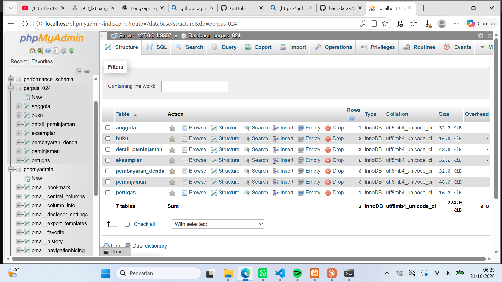
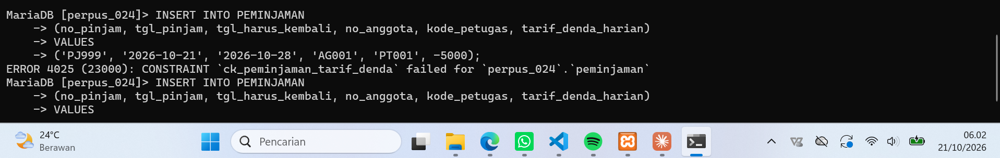
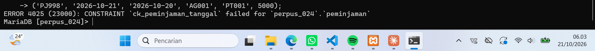

# Laporan Praktikum Basis Data - Pertemuan 05

**Nama:** Imam Khoiri  
**NIM:** 25430024  
**Kelas:** A  
**Mata Kuliah:** Basis Data  
**Modul:** 5 — Membuat Struktur Tabel dengan DDL  
**Proyek:** Perpustakaan Digital Raharsa Inspirasi

---

## 1. Tujuan Praktikum

1. Memahami penggunaan Data Definition Language (DDL) untuk membangun struktur basis data.
2. Membuat tabel sesuai hasil normalisasi pada Modul 4.
3. Menerapkan primary key, foreign key, unique, dan check constraint.
4. Menguji constraint untuk memastikan basis data menolak data yang tidak sesuai aturan.
5. Menyimpan skrip SQL dan laporan praktikum dalam repositori Git.

## 2. Ringkasan Dasar Teori

Data Definition Language (DDL) merupakan bagian dari SQL yang digunakan untuk membuat dan mengelola struktur basis data. Perintah DDL yang digunakan pada praktikum ini meliputi `CREATE DATABASE`, `CREATE TABLE`, dan `DROP TABLE`.

Constraint digunakan untuk menjaga integritas data. `PRIMARY KEY` mengidentifikasi setiap baris secara unik, `FOREIGN KEY` menjaga hubungan antartabel, `UNIQUE` mencegah nilai tertentu berulang, sedangkan `CHECK` membatasi nilai atribut berdasarkan kondisi yang ditentukan.

Storage engine InnoDB digunakan untuk mendukung relasi foreign key. Skrip DDL disusun agar dapat dijalankan kembali dengan menghapus tabel dalam urutan yang memperhatikan ketergantungan antartabel.

## 3. Hasil Langkah Percobaan

### 3.1 Pembuatan basis data

Basis data proyek dibuat dengan nama `perpus_024`. Skrip SQL dijalankan melalui XAMPP Shell menggunakan MariaDB pada port 3307.

**Bukti:**  

### 3.2 Pembuatan tabel

Skrip `p05_ddl_25430024.sql` digunakan untuk membentuk tujuh tabel berikut:

| No. | Tabel | Fungsi |
|---|---|---|
| 1 | ANGGOTA | Menyimpan identitas anggota |
| 2 | BUKU | Menyimpan informasi bibliografi buku |
| 3 | EKSEMPLAR | Menyimpan data salinan fisik buku |
| 4 | PETUGAS | Menyimpan identitas petugas |
| 5 | PEMINJAMAN | Menyimpan transaksi peminjaman |
| 6 | DETAIL_PEMINJAMAN | Menyimpan rincian eksemplar yang dipinjam |
| 7 | PEMBAYARAN_DENDA | Menyimpan pembayaran denda |

**Bukti:**  

### 3.3 Pengujian constraint

Pengujian dilakukan dengan memberikan data yang sengaja melanggar aturan untuk memastikan database menolaknya.

| Pengujian | Hasil yang diharapkan | Hasil |
|---|---|---|
| NIM/NIP anggota duplikat | Ditolak oleh UNIQUE | Ditolak |
| ISBN buku yang tidak terdaftar pada EKSEMPLAR | Ditolak oleh FOREIGN KEY | Ditolak |
| Tarif denda harian negatif | Ditolak oleh CHECK | Ditolak |
| Tanggal wajib kembali lebih awal dari tanggal pinjam | Ditolak oleh CHECK | Ditolak |

Pengujian tarif denda negatif menghasilkan pesan `ERROR 4025 (23000)` dengan constraint `ck_peminjaman_tarif_denda`. Hal tersebut menunjukkan bahwa constraint menolak nilai negatif.

Pengujian tanggal kembali yang lebih awal daripada tanggal peminjaman juga ditolak oleh database karena melanggar constraint tanggal.

**Bukti:**  

## 4. Jawaban Titik Analisis

### 4.1 Mengapa primary key diperlukan?

Primary key diperlukan untuk mengidentifikasi setiap baris secara unik sehingga tidak ada dua data yang memiliki identitas utama yang sama.

### 4.2 Apa fungsi foreign key?

Foreign key menjaga konsistensi relasi antartabel. Data pada tabel anak harus merujuk pada data yang tersedia di tabel induk.

### 4.3 Mengapa menggunakan UNIQUE?

UNIQUE digunakan untuk mencegah nilai tertentu berulang. Pada tabel ANGGOTA, constraint ini mencegah NIM/NIP anggota yang sama terdaftar lebih dari satu kali.

### 4.4 Apa fungsi CHECK?

CHECK membatasi nilai atribut berdasarkan kondisi yang ditetapkan. Contohnya, tarif denda tidak boleh negatif dan tanggal wajib kembali tidak boleh lebih awal daripada tanggal peminjaman.

### 4.5 Mengapa menggunakan InnoDB?

InnoDB digunakan karena mendukung foreign key dan membantu menjaga integritas hubungan antartabel.

## 5. Hasil Latihan dan Modifikasi

Skrip DDL disesuaikan dengan proyek Perpustakaan Digital Raharsa Inspirasi berdasarkan hasil normalisasi Modul 4. Tujuh tabel dibuat dengan primary key, foreign key, unique, dan check constraint sesuai kebutuhan struktur basis data.

Skrip juga dilengkapi perintah verifikasi struktur tabel. Pengujian dilakukan untuk memeriksa penolakan data yang melanggar constraint.

## 6. Tugas Mandiri: Milestone Proyek 5

Milestone Modul 5 adalah pembuatan struktur fisik basis data menggunakan DDL. Hasil pengerjaan berupa:

1. File SQL `p05_ddl_25430024.sql`.
2. Basis data `perpus_024` pada MariaDB.
3. Tujuh tabel sesuai rancangan normalisasi Modul 4.
4. Pengujian constraint pada beberapa kondisi data yang tidak valid.
5. Dokumentasi hasil pengerjaan dalam laporan Markdown.

## 7. Pembahasan dan Kendala

Kendala awal terjadi saat menghubungkan terminal ke MariaDB. Koneksi berhasil setelah menggunakan port 3307, sesuai port yang digunakan server database.

Pengujian constraint memperlihatkan bahwa database menolak data yang melanggar aturan. Pengujian tersebut membantu memastikan bahwa validasi tidak hanya bergantung pada aplikasi, tetapi juga diterapkan pada tingkat basis data.

## 8. Kesimpulan

Praktikum Modul 5 memberikan pemahaman mengenai pembuatan struktur tabel menggunakan DDL. Struktur basis data proyek berhasil dibuat menggunakan tujuh tabel. Pengujian menunjukkan bahwa beberapa constraint bekerja sesuai tujuan, yaitu menolak data anggota duplikat, referensi buku yang tidak tersedia, tarif denda negatif, dan tanggal wajib kembali yang tidak valid.

## 9. Pernyataan Penggunaan AI

AI digunakan sebagai pendamping untuk memahami konsep DDL, menyusun skrip SQL, mengatasi kendala koneksi MariaDB, dan membantu menyusun dokumentasi praktikum. Seluruh perintah dan hasil pengujian perlu diverifikasi kembali berdasarkan kondisi database yang sebenarnya.

## 10. Bukti Git

**Repositori:**  
https://github.com/Rifkyirangga/basisdata-25430024

**Commit Modul 5:**  
 hash commit 21d53e5 

## Checklist

- [x] Skrip DDL dibuat dan dijalankan.
- [x] Tujuh tabel proyek terbentuk.
- [x] Pengujian constraint dilakukan.
- [x] Bukti pengujian disimpan.
- [ ] Laporan diperiksa dan dilengkapi screenshot.
- [ ] Perubahan di-commit dan di-push ke GitHub.
- [ ] ERD fisik dilengkapi jika diwajibkan dalam panduan praktikum.